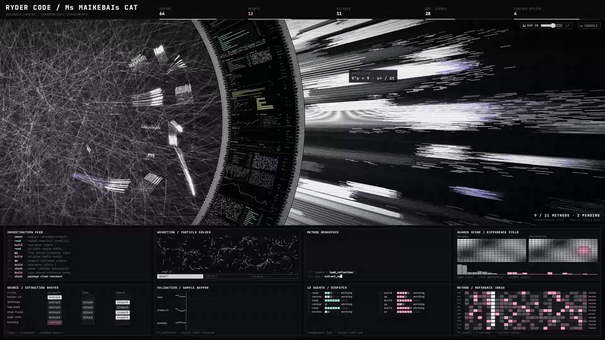
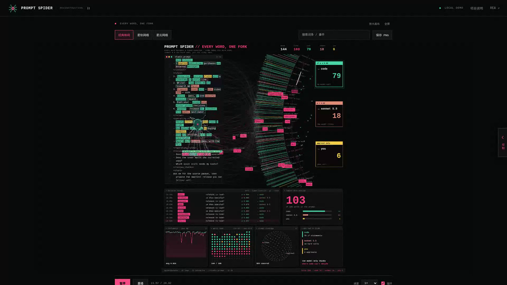

# Video Collection · 项目预览视频收集

> 开源可视化项目的完整预览视频合集 / A collection of complete preview videos for open-source visualization projects.

本仓库收集并制作开源项目的**完整预览视频**：在本地真实运行项目，使用无头浏览器（Headless Chromium）以 **1920×1080 / 25fps** 录制实际画面，再编码为 H.264 MP4。所见的每一帧都是项目真实运行的效果，没有任何后期合成。

| # | 项目 | 视频 | 时长 | 分辨率 |
|---|------|------|------|--------|
| 1 | [HALOFLUX](https://github.com/Ryder191/haloflux) | [haloflux/haloflux-preview.mp4](haloflux/haloflux-preview.mp4) | 1:17 | 1920×1080 |
| 2 | [Prompt Spider UI](https://github.com/Kirito14IT/prompt-spider-ui) | [prompt-spider-ui/prompt-spider-ui-preview.mp4](prompt-spider-ui/prompt-spider-ui-preview.mp4) | 0:53 | 1920×1080 |

---

## 1. HALOFLUX — 节拍驱动的科幻光环可视化

**项目地址**：<https://github.com/Ryder191/haloflux> · 作者 Ryder191（RYDER CODE / Ms MAIKEBAIs CAT）

一个全屏、节拍驱动的科幻数据可视化：中心是编织状的光场核心，外面是一圈由微型数据面板组成的旋转圆环，环外有多层向外迸发的光束。纯原生 Canvas、单个 HTML 文件、零依赖，支持 Wallpaper Engine 动态壁纸。

### 视频内容（1:17，含原创背景音乐）

- **00:00 – 00:25** — 默认预设「我的默认」：不均匀节拍时钟驱动的光环、微型数据面板与五层光束，自动运镜在 7 个镜头间推拉；
- **00:25 – 00:50** — 按 `C` 打开 **CONSOLE 实时调参面板**：56 个参数的滑杆实时生效（演示「柔光层强度」调整），并在面板内切换 **预设 B（亮线）** 与 **预设 A（暗底）**；
- **00:50 – 01:17** — 恢复默认预设收尾。

**在线观看（GitHub 内嵌播放器）：**

### 致谢与许可

- HALOFLUX © 2026 Ryder191（RYDER CODE / Ms MAIKEBAIs CAT），按 [PolyForm Noncommercial License 1.0.0](https://github.com/Ryder191/haloflux/blob/main/LICENSE) 授权。本视频为其画面的非商业演示用途（Noncommercial use only），转载或二次创作请注明 **「HALOFLUX by Ryder191（RYDER CODE / Ms MAIKEBAIs CAT）」** 及原项目链接，**严禁任何商业用途**。
- 背景音乐：**"Synthwave 421k"** — The Cynic Project（cynicmusic），出自 *Pixelsphere* 原声，以 **CC0** 发布于 [OpenGameArt](https://opengameart.org/users/cynicmusic)。

---

## 2. Prompt Spider UI — 提示词蛛网分流可视化

**项目地址**：<https://github.com/Kirito14IT/prompt-spider-ui> · 作者 Kirito14IT（MIT License）

原生 JavaScript + Canvas 2D 的机械蜘蛛可视化 UI：机械蜘蛛沿文字游走、伸出触手抓取词语，词条沿弧线飞入蛛网，再分流到 `code`、`model` 和 `you` 三条分支。支持 MCP 接入自己的 Agent、星轨/星云网络视图、主题定制、JSON 回放与独立项目导出。

### 视频内容（0:53）

- **00:00 – 00:24** — **参考演示**完整周期：逐词扫描、弧形抓取、蛛网分流、双拍心跳与动态统计（175 次分流：137 code / 27 model / 11 you）；
- **00:24 – 00:29** — 点击画布词条，右侧面板展开**词条详情**（问题、示意分数、分支）；
- **00:29 – 00:36** — **星轨网络**视图：三条分支轨道上的节点旋转；
- **00:36 – 00:44** — **星云网络**视图：带远近层次的球面节点与分支连线；
- **00:44 – 00:53** — 返回经典蛛网视图收尾。

**在线观看（GitHub 内嵌播放器）：**

### 致谢与许可

- Prompt Spider UI © Kirito14IT，按 [MIT License](https://github.com/Kirito14IT/prompt-spider-ui/blob/main/LICENSE) 授权。

---

## 制作方式 · How the videos were made

1. 本地运行原项目（HALOFLUX 静态服务 / Prompt Spider UI `node server.mjs`）；
2. 无头 Chromium 以 1920×1080 视口打开页面，Playwright 录制真实屏幕输出（25fps WebM）；
3. 脚本驱动键盘与鼠标完成真实交互：打开调参面板、切换预设、切换视图、点击词条——全部为实际运行效果；
4. FFmpeg 编码为 H.264 MP4（yuv420p + faststart）；HALOFLUX 视频按页面加载时刻对齐混入其自带的 CC0 背景音乐。

> 想让你的项目也出现在这里？欢迎提 Issue 推荐下一个值得录制的可视化项目。
